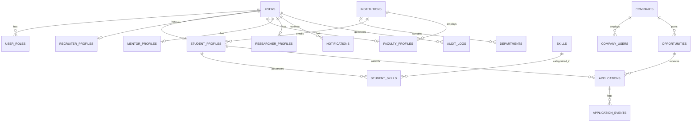

# MITRA — Database Schema & Entity Relationships

This document details the normalized relational database schema designed for PostgreSQL (Supabase), incorporating constraints, indexes, cascade behaviors, and audit trails.

---

## 1. Entity-Relationship Diagram (ERD)

---

## 2. Table Specifications

### A. Core Authentication & Identity
- `users`:
  - `id` (UUID, PK) — References Supabase `auth.users.id`.
  - `email` (VARCHAR(320), UNIQUE, INDEX).
  - `display_name` (VARCHAR(160)).
  - `avatar_url` (TEXT, NULLABLE).
  - `phone_number` (VARCHAR(32), NULLABLE).
  - `is_active` (BOOLEAN, DEFAULT true).
  - `created_at` (TIMESTAMPTZ, DEFAULT now()).
  - `updated_at` (TIMESTAMPTZ, DEFAULT now()).
- `user_roles`:
  - `id` (SERIAL, PK).
  - `user_id` (UUID, FK -> `users.id`, ON DELETE CASCADE).
  - `role` (VARCHAR(40), INDEX) — Enum: `STUDENT`, `RECRUITER`, `INSTITUTION_ADMIN`, `FACULTY`, `MENTOR`, `RESEARCHER`, `PLATFORM_ADMIN`.
  - UNIQUE(`user_id`, `role`).

### B. Student Domain & Skill Passport
- `student_profiles`:
  - `user_id` (UUID, PK, FK -> `users.id`, ON DELETE CASCADE).
  - `institution_id` (UUID, NULLABLE, FK -> `institutions.id`, ON DELETE SET NULL).
  - `department` (VARCHAR(160), NULLABLE).
  - `degree` (VARCHAR(120), NULLABLE).
  - `graduation_year` (INTEGER, NULLABLE).
  - `current_year` (INTEGER, DEFAULT 1).
  - `career_goal` (VARCHAR(240), NULLABLE).
  - `resume_url` (TEXT, NULLABLE).
  - `github_url` (TEXT, NULLABLE).
  - `linkedin_url` (TEXT, NULLABLE).
  - `profile_completion` (INTEGER, DEFAULT 0).
  - `career_readiness_score` (NUMERIC(5,2), DEFAULT 0.0).
  - `created_at`, `updated_at` (TIMESTAMPTZ).
- `skills`:
  - `id` (UUID, PK, DEFAULT gen_random_uuid()).
  - `name` (VARCHAR(120), UNIQUE, INDEX).
  - `category` (VARCHAR(80), DEFAULT 'Technical').
  - `description` (TEXT, NULLABLE).
- `student_skills`:
  - `id` (SERIAL, PK).
  - `user_id` (UUID, FK -> `users.id`, ON DELETE CASCADE, INDEX).
  - `skill_id` (UUID, FK -> `skills.id`, ON DELETE CASCADE, INDEX).
  - `proficiency_level` (INTEGER, CHECK (proficiency_level BETWEEN 1 AND 5)).
  - `source` (VARCHAR(80), DEFAULT 'Self-reported').
  - `is_verified` (BOOLEAN, DEFAULT false).
  - `verified_by` (VARCHAR(160), NULLABLE).
  - UNIQUE(`user_id`, `skill_id`).

### C. Institutional Domain
- `institutions`:
  - `id` (UUID, PK, DEFAULT gen_random_uuid()).
  - `name` (VARCHAR(240), INDEX, NOT NULL).
  - `institution_type` (VARCHAR(80), DEFAULT 'University').
  - `website` (TEXT, NULLABLE).
  - `location` (VARCHAR(160), NULLABLE).
  - `description` (TEXT, NULLABLE).
  - `verified` (BOOLEAN, DEFAULT false, INDEX).
  - `created_at`, `updated_at` (TIMESTAMPTZ).
- `departments`:
  - `id` (SERIAL, PK).
  - `institution_id` (UUID, FK -> `institutions.id`, ON DELETE CASCADE).
  - `name` (VARCHAR(160), NOT NULL).
  - `student_count` (INTEGER, DEFAULT 0).
  - `placement_rate` (NUMERIC(5,2), DEFAULT 0.0).
  - `avg_stipend` (NUMERIC(10,2), DEFAULT 0.0).

### D. Corporate & Opportunity Domain
- `companies`:
  - `id` (UUID, PK, DEFAULT gen_random_uuid()).
  - `name` (VARCHAR(240), INDEX, NOT NULL).
  - `industry` (VARCHAR(120), NULLABLE).
  - `website` (TEXT, NULLABLE).
  - `logo_url` (TEXT, NULLABLE).
  - `location` (VARCHAR(160), NULLABLE).
  - `company_size` (VARCHAR(60), NULLABLE).
  - `verified` (BOOLEAN, DEFAULT false, INDEX).
  - `created_at`, `updated_at` (TIMESTAMPTZ).
- `company_users`:
  - `id` (SERIAL, PK).
  - `company_id` (UUID, FK -> `companies.id`, ON DELETE CASCADE, INDEX).
  - `user_id` (UUID, FK -> `users.id`, ON DELETE CASCADE, INDEX).
  - `membership_role` (VARCHAR(40), DEFAULT 'RECRUITER').
  - UNIQUE(`company_id`, `user_id`).
- `opportunities`:
  - `id` (UUID, PK, DEFAULT gen_random_uuid()).
  - `company_id` (UUID, FK -> `companies.id`, ON DELETE RESTRICT, INDEX).
  - `created_by` (UUID, FK -> `users.id`, ON DELETE RESTRICT, INDEX).
  - `title` (VARCHAR(240), NOT NULL, INDEX).
  - `description` (TEXT, NOT NULL).
  - `responsibilities` (TEXT, NULLABLE).
  - `opportunity_type` (VARCHAR(40), DEFAULT 'internship', INDEX).
  - `work_mode` (VARCHAR(30), DEFAULT 'hybrid').
  - `location` (VARCHAR(160), NULLABLE).
  - `duration` (VARCHAR(80), NULLABLE).
  - `stipend_min` (NUMERIC(10,2), NULLABLE).
  - `stipend_max` (NUMERIC(10,2), NULLABLE).
  - `eligibility` (TEXT, NULLABLE).
  - `application_deadline` (DATE, NULLABLE).
  - `required_skills` (JSONB, DEFAULT '[]'::jsonb).
  - `status` (VARCHAR(30), DEFAULT 'open', INDEX).
  - `created_at`, `updated_at` (TIMESTAMPTZ).

### E. Application & Lifecycle Domain
- `applications`:
  - `id` (UUID, PK, DEFAULT gen_random_uuid()).
  - `student_id` (UUID, FK -> `users.id`, ON DELETE CASCADE, INDEX).
  - `opportunity_id` (UUID, FK -> `opportunities.id`, ON DELETE CASCADE, INDEX).
  - `resume_url` (TEXT, NULLABLE).
  - `cover_letter` (TEXT, NULLABLE).
  - `match_score` (NUMERIC(5,2), NULLABLE).
  - `match_explanation` (JSONB, DEFAULT '{}'::jsonb).
  - `status` (VARCHAR(40), DEFAULT 'applied', INDEX).
  - `recruiter_feedback` (TEXT, NULLABLE).
  - `created_at`, `updated_at` (TIMESTAMPTZ).
  - UNIQUE(`student_id`, `opportunity_id`).
- `application_events`:
  - `id` (SERIAL, PK).
  - `application_id` (UUID, FK -> `applications.id`, ON DELETE CASCADE, INDEX).
  - `actor_id` (UUID, FK -> `users.id`, ON DELETE RESTRICT).
  - `old_status` (VARCHAR(40), NULLABLE).
  - `new_status` (VARCHAR(40), NOT NULL).
  - `created_at` (TIMESTAMPTZ, DEFAULT now()).

### F. Audit & Telemetry
- `audit_logs`:
  - `id` (SERIAL, PK).
  - `actor_id` (UUID, FK -> `users.id`, ON DELETE SET NULL, INDEX).
  - `action` (VARCHAR(120), NOT NULL, INDEX).
  - `resource_type` (VARCHAR(80), NOT NULL).
  - `resource_id` (VARCHAR(80), NULLABLE).
  - `details` (JSONB, DEFAULT '{}'::jsonb).
  - `created_at` (TIMESTAMPTZ, DEFAULT now()).
